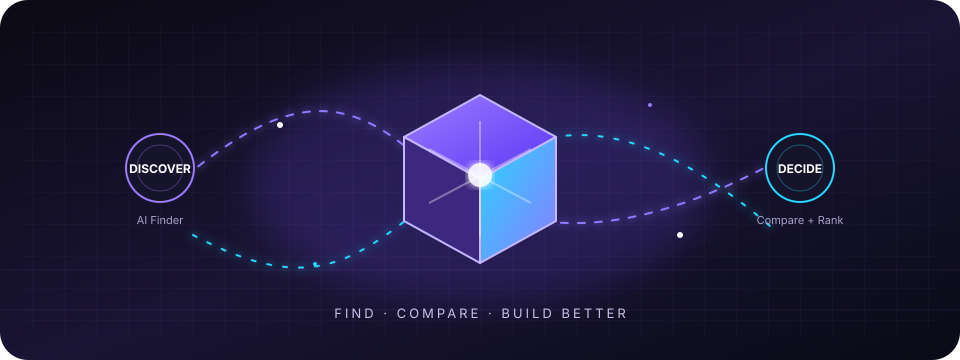

<div align="center">


# Optima

### The AI Decision Engine

Discover, compare, rank, and build with the right AI tools for every workflow.

<p>
  <a href="https://optima-ai.pages.dev/">Live application</a> ·
  <a href="mailto:optimainc2026@gmail.com">Report a bug</a> ·
  <a href="mailto:optimainc2026@gmail.com">Request a feature</a>
</p>



<p>
  
  
  
  
  
</p>

</div>

## What is Optima?

AI tools are multiplying faster than anyone can evaluate them. Optima turns that
choice into a guided, data-driven workflow instead of a pile of browser tabs.

The platform helps students, developers, founders, creators, researchers, and
teams answer:

- Which AI tool is best for this job?
- Which tools are worth comparing?
- What will the workflow cost?
- How can several tools work together as a stack?

## Product experience

| Experience | What it does |
| --- | --- |
| **AI Finder** | Asks a short set of questions and recommends a tailored AI stack. |
| **Rankings** | Explores category-based leaderboards and tool scores. |
| **Compare** | Places tools side by side so capabilities, pricing, and trade-offs are easy to evaluate. |
| **Agent Hub** | Helps users discover agent-building platforms and automation tools. |
| **Public Stacks** | Shows curated combinations of tools for practical workflows. |
| **Prompt Library** | Provides reusable prompts that users can copy, save, and adapt. |
| **Cost Calculator** | Estimates monthly spend across APIs, agents, and SaaS products. |
| **Authentication** | Supports email/password and Google sign-in through Firebase Authentication. |
| **Admin workspace** | Provides protected operational, content, monitoring, and support surfaces. |

## Highlights

- Responsive layouts for desktop, tablet, and mobile.
- TanStack Router navigation with server-rendered routes.
- Interactive recommendations and filtering backed by structured tool data.
- Protected routes, email verification, password reset, and onboarding flows.
- Reusable Radix UI primitives and Tailwind CSS styling.
- Cloudflare Pages deployment through Nitro's Cloudflare preset.
- Unit tests with Vitest and browser tests with Playwright.
- Edge-safe SSR handling for Cloudflare Workers, including graceful database fallbacks.

## Architecture

```text
Browser
  │
  ├── React 19 UI
  ├── TanStack Router + React Query
  ├── Firebase client authentication
  └── Responsive Tailwind/Radix components
          │
          ▼
TanStack Start / Nitro server runtime
  │
  ├── Server functions and route loaders
  ├── Auth, validation, rate limiting, and CSRF middleware
  ├── Drizzle ORM data access
  └── Cloudflare Pages Worker deployment
```

## Technology stack

### Application

- React 19
- TypeScript
- TanStack Start
- TanStack Router
- TanStack Query
- Vite

### UI and interaction

- Tailwind CSS
- Radix UI
- Framer Motion
- Lucide React
- Recharts
- React Hook Form
- Zod

### Data and services

- Firebase Authentication
- Supabase
- Drizzle ORM
- SQLite for local development and compatible server-side paths
- Nodemailer / Resend-compatible email flows

### Quality and delivery

- Vitest
- Testing Library
- Playwright
- ESLint
- Prettier
- Cloudflare Pages

## Getting started

### Prerequisites

- Node.js 20 or newer
- npm
- A Firebase project for browser authentication
- Supabase project credentials if using Supabase-backed features

### Install

```bash
git clone https://github.com/Vishnunair585/Optima.git
cd Optima
npm install
```

### Configure environment

Create a local `.env` file. Never commit it.

```dotenv
# Local server/data
DATABASE_URL=sqlite.db
SESSION_SECRET=replace-with-a-long-random-secret

# Firebase web configuration
VITE_FIREBASE_API_KEY=
VITE_FIREBASE_AUTH_DOMAIN=
VITE_FIREBASE_PROJECT_ID=
VITE_FIREBASE_STORAGE_BUCKET=
VITE_FIREBASE_MESSAGING_SENDER_ID=
VITE_FIREBASE_APP_ID=

# Supabase public client configuration
VITE_SUPABASE_URL=
VITE_SUPABASE_ANON_KEY=

# Optional email configuration
SMTP_HOST=
SMTP_PORT=587
SMTP_USER=
SMTP_PASS=
SMTP_FROM=
RESEND_API_KEY=
SUPPORT_EMAIL=
```

Firebase web configuration is client configuration, but service-account keys,
SMTP passwords, session secrets, and other server credentials must remain
private. Add the local and production domains to Firebase Authentication's
authorized domains before testing Google sign-in.

### Run locally

```bash
npm run dev
```

The development server is normally available at
[`http://localhost:8080`](http://localhost:8080).

## Scripts

| Command | Purpose |
| --- | --- |
| `npm run dev` | Start the Vite development server. |
| `npm run build` | Create the production Cloudflare Pages bundle. |
| `npm run preview` | Preview the generated build with Vite. |
| `npm test -- --run` | Run the Vitest suite once. |
| `npm run test:e2e` | Run Playwright browser tests. |
| `npm run test:e2e:ci` | Run Chromium E2E tests in CI mode. |
| `npm run lint` | Run ESLint. |
| `npm run format` | Format the repository with Prettier. |
| `npm run db:push` | Push the Drizzle schema to the configured local database. |
| `npm run db:generate` | Generate Drizzle migration files. |

## Project structure

```text
Optima/
├── public/                  # Static files and PWA assets
├── docs/                    # Project documentation assets
├── src/
│   ├── components/          # Shared UI, auth, layouts, and feature components
│   ├── hooks/               # Reusable React hooks
│   ├── lib/
│   │   ├── api/             # Server functions and API helpers
│   │   ├── data/            # Tool, agent, prompt, and stack data
│   │   ├── db/              # Drizzle schema and database access
│   │   ├── security/        # Validation, CSRF, rate limiting, and authz
│   │   └── monitoring/      # Logging, metrics, and operational helpers
│   ├── routes/              # TanStack file-based routes
│   ├── server/              # Server-only authentication utilities
│   ├── services/            # Intelligence and domain services
│   ├── router.tsx           # Router creation
│   └── server.ts            # Cloudflare-compatible server entrypoint
├── tests/                   # End-to-end and security tests
├── drizzle/                 # Database migration metadata
├── vite.config.ts           # Vite/TanStack/Nitro configuration
└── package.json             # Scripts and dependencies
```

## Testing checklist

Before opening a pull request:

```bash
npm test -- --run
npm run build
npm run lint
npm run test:e2e:ci
```

For authentication tests, use a dedicated Firebase test project or test
accounts. Do not use real user passwords or production credentials in tests.

## Deployment

Optima is configured for Cloudflare Pages with the Cloudflare Workers runtime.
The production build is generated by:

```bash
npm run build
```

The resulting output is in `dist/`, including the generated Cloudflare Worker
entrypoint and Pages routing metadata. Configure the required variables in the
Cloudflare Pages project before deploying.

## Security notes

- Keep `.env` and all server credentials out of Git.
- Use Firebase authorized domains for production and preview environments.
- Validate untrusted input at server-function boundaries.
- Keep protected routes behind the existing auth and role middleware.
- Review database and email provider permissions before production use.
- Report suspected vulnerabilities privately through the project email.

## Contributing

1. Fork the repository.
2. Create a focused branch:

   ```bash
   git checkout -b feat/your-change
   ```

3. Make the smallest complete change that solves the problem.
4. Run the relevant tests, build, and lint checks.
5. Open a pull request with a clear description and validation steps.

## Roadmap

- More explainable recommendation scores.
- Community reviews and verified usage signals.
- Personalized workspaces and saved decision history.
- Team collaboration and shared AI stacks.
- Public APIs and workflow automation.
- Browser and mobile experiences.

## Live project

**Production:** [optima-ai.pages.dev](https://optima-ai.pages.dev/)

## Maintainer

**Vishnu M**

For questions, bug reports, and feature requests:
[optimainc2026@gmail.com](mailto:optimainc2026@gmail.com)

<div align="center">

### If Optima helps you choose better tools, consider starring the repository.

</div>
